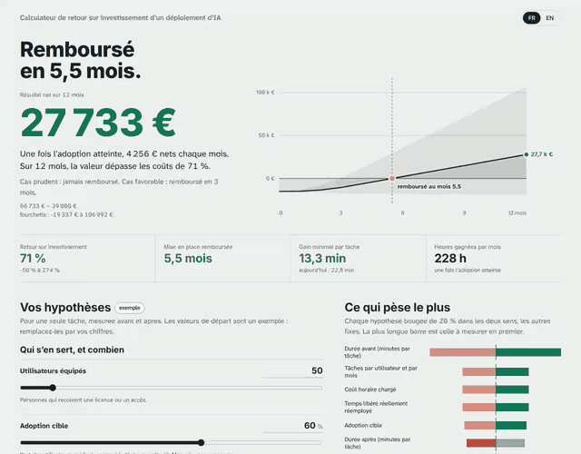

# ai-roi-value-case

Calculateur de retour sur investissement d’un déploiement d’IA et modèle de dossier de valeur, en français et en anglais. / AI deployment ROI calculator and value-case template, in French and English.

## Français

Une page web, sans serveur ni compte, qui répond pour une tâche précise à trois questions : ce que coûte l’outil, ce qu’il fait gagner, et à partir de quand il est rentable. Le calcul se colle ensuite dans un modèle de dossier de valeur qui impose une mesure avant et après.

Ce que fait la page (`index.html`) :

- un verdict en une phrase et la courbe de trésorerie cumulée, avec le mois où la mise en place est remboursée ;
- une fourchette : une valeur prudente et une valeur favorable pour l’adoption, la durée après, la part des reprises et le temps réemployé, tracées en bande autour de la courbe ;
- la montée en charge de l’adoption (adoption au premier mois, mois pour atteindre la cible) et un taux d’actualisation facultatif ;
- les chronométrages bruts : on colle les durées mesurées avant et après, la page donne les moyennes, l’intervalle de confiance à 95 % du gain par tâche (Welch) et remplit les champs ;
- ce qui pèse le plus : chaque hypothèse bougée de 20 % dans les deux sens ;
- la comparaison de deux calculs, le calcul gardé restant tracé en pointillé ;
- trois postes souvent oubliés : les sorties à reprendre, la part du temps libéré réellement réemployée, les licences payées pour des utilisateurs qui ne s’en servent pas ;
- l’export en Markdown pour le dossier de valeur, un lien qui garde le calcul, une version imprimable d’une page.

Les autres fichiers :

- `template/value-case.fr.md` : le modèle de dossier de valeur (décision demandée, situation de départ, indicateurs, protocole de mesure, risques et conditions d’arrêt, revues à 30, 60 et 90 jours) ;
- `examples/bim-model-checking.fr.md` : un exemple rempli à partir de deux mesures réelles d’un logiciel de contrôle de maquettes BIM, les hypothèses marquées comme telles.

### Formules (`src/roi.mjs`, `src/stats.mjs`)

- adoption du mois m : adoption au premier mois, puis montée régulière jusqu’à l’adoption cible au mois indiqué ;
- tâches du mois = utilisateurs × tâches par utilisateur × adoption du mois ;
- minutes nettes par tâche = durée avant − durée après − part des reprises × durée d’une reprise ;
- valeur du mois = tâches × minutes nettes ÷ 60 × coût horaire × part du temps réemployé ;
- coût du mois = utilisateurs × licence + tâches × coût d’API par tâche + exploitation ;
- chaque mois est divisé par (1 + taux annuel) puissance (m ÷ 12) ; la mise en place est payée au mois 0 ;
- retour sur investissement = (valeur − coût) ÷ coût sur l’horizon, mise en place comprise ;
- remboursement : premier passage de la trésorerie cumulée au-dessus de zéro, cherché jusqu’à 50 ans ;
- gain minimal par tâche : minutes nettes qui annulent le résultat sur l’horizon ;
- gain par tâche mesuré : différence des moyennes, intervalle de Welch au seuil de 95 %.

### Vérification

- `node --test 'test/*.test.mjs'` : 47 tests du calcul et des statistiques, dont une simulation de trésorerie mois par mois écrite séparément et comparée au calcul sur 5 000 jeux d’hypothèses tirés au hasard.
- `npm ci` puis `npx vitest run` : 21 tests de fumée qui chargent la vraie page dans un DOM simulé (happy-dom) et la manipulent comme un utilisateur.
- `node scripts/check-layout.cjs` : textes qui se chevauchent, débordements et contenu hors écran, à six largeurs de 320 à 1360 px, en français et en anglais, dans six états de la page (Playwright, serveur local sur le port 8766).

Lancer en local : `python3 -m http.server 8766` à la racine, puis ouvrir `http://localhost:8766`. Le module JavaScript ne se charge pas en ouvrant le fichier directement. Refaire la démo : `node scripts/demo.cjs`.

## English

A web page, with no server or account, that answers three questions for one specific task: what the tool costs, what it saves, and when it pays off. The calculation then goes into a value-case template that requires a before and after measurement.

What the page (`index.html`) does:

- a one-sentence verdict and the cumulative cash curve, with the month the setup is paid back;
- a range: a prudent and a favorable value for adoption, time after, rework share and redeployed time, drawn as a band around the curve;
- adoption ramp-up (adoption in month one, months to reach the target) and an optional discount rate;
- raw timings: paste the durations measured before and after, the page gives the means, the 95% confidence interval of the saving per task (Welch) and fills the fields;
- what weighs most: each assumption moved 20% either way;
- comparison of two calculations, the kept one staying on the chart as a dotted line;
- three items often left out: outputs that need rework, the share of freed time actually redeployed, seats paid for people who do not use the tool;
- Markdown export for the value case, a link that keeps the calculation, a one-page print version.

The other files:

- `template/value-case.en.md`: the value-case template (decision requested, baseline, indicators, measurement protocol, risks and stop conditions, reviews at 30, 60 and 90 days);
- `examples/bim-model-checking.en.md`: a filled example based on two real measurements from a BIM model checking product, assumptions marked as such.

Formulas are listed in the French section above and implemented in `src/roi.mjs` and `src/stats.mjs`.

Checks: `node --test 'test/*.test.mjs'` (47 tests, including an independent month-by-month cash simulation compared on 5,000 random inputs), `npx vitest run` after `npm ci` (21 smoke tests of the real page), `node scripts/check-layout.cjs` (overlaps and overflow at six widths, two languages, six page states).

Run locally: `python3 -m http.server 8766` at the root, then open `http://localhost:8766`. The JavaScript module does not load when the file is opened directly.

## Licence

MIT.
